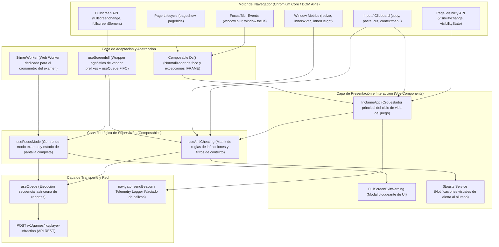

# ARQUITECTURA DE SUPERVISIÓN Y CONTROL — WAYGROUND (QUIZIZZ)

**Estado de verificación:** Código fuente comprobado mediante desminificación e inspección estática de chunks de producción (`index.B79U7qC1.js`, `InGameApp.DILvyiP8.js`, `useAntiCheating.DbXxYjR9.js`, `useFocusMode.VI9SmPm8.js`, `useScreenfull.DjUvoJkM.js`).

---

## 1. Mapa de Dependencias y Responsabilidades



---

## 2. Matriz de Componentes y Flujo de Eventos

| Evento / Sensor DOM | Componente Registrador | Receptor / Handler | Procesamiento y Validación | Presentación Visual | Transporte al Servidor |
| :--- | :--- | :--- | :--- | :--- | :--- |
| **`fullscreenchange`** | `useScreenfull` (`l.on('change')`) | `Pe()` en `useAntiCheating` y `r()` en `useScreenfull` | Evalúa si `!isFullscreen`. Filtro: `isDesktop && !isImpersonation`. Cooldown de 1500 ms (`ie()`). | Modal `FullScreenExitWarning` + Toast *"Your teacher has been alerted..."* | `POST /player-infraction`<br>`{ infractionType: "fullscreenExitDetected" }` |
| **`visibilitychange`** | `InGameApp` (`mounted`) | `handleVisibilityChange()` | Evalúa transiciones `"hidden"` vs `"visible"`. Registra `timeSpent` si vuelve a `"visible"`. | No bloquea UI de inmediato; delega en la pérdida de foco. | `navigator.sendBeacon` (flush al ocultar) y log analítico `APP_VISIBILITY_CHANGE`. |
| **`window.blur`** | `Dc()` en `InGameApp` | `l()` en `Dc()` $\rightarrow$ `O()` en `useAntiCheating` | **Excepción:** Si `activeElement.tagName === "IFRAME"` y conserva foco, se ignora.<br>**Grace Period:** Inicia contador `y.value = Date.now()`. | Toast si la ausencia supera los 3000 ms. | Condicionado a `window.focus`. |
| **`window.focus`** | `Dc()` en `InGameApp` | `l()` en `Dc()` $\rightarrow$ `O()` en `useAntiCheating` | Calcula `timeOutOfFocus = Date.now() - y.value`. Si `timeOutOfFocus > 3000 ms`, activa la infracción. | Toast *"Your teacher has been alerted that you left the tab."* | `POST /player-infraction`<br>1. `playerExited`<br>2. `playerResumed` (+ `timeOutOfFocus`) |
| **`copy` / `cut`** | `useAntiCheating` / `InGameApp` | `handleCopyEvent()` (`Le`) | Si `disableCopyPaste` está activo: `e.preventDefault()`. | Toast *"Your teacher has been alerted that you copy pasted content."* | `POST /player-infraction`<br>`{ infractionType: "pasteDetected" }` |
| **`paste`** | `useAntiCheating` | `handlePasteEvent()` (`we`) | Si `disableCopyPaste` está activo: `e.preventDefault()`. Extrae `clipboardLength`. | Toast *"Your teacher has been alerted that you copy pasted content."* | `POST /player-infraction`<br>`{ infractionType: "pasteDetected", infractionMeta: { clipboardLength } }` |
| **`contextmenu`** | `InGameApp` y `useAntiCheating` | `handleRightClickEvent()` (`Ge`) | Si `disableRightClick`: `e.preventDefault()`. Si no, se bufferiza en `d.value` para envío por lotes. | Toast *"Your teacher has been alerted that you right-clicked."* | `POST /player-infraction`<br>`{ infractionType: "rightClickDetected" }` |
| **`resize`** | `useAntiCheating` | `handleWindowResize()` (`ae`) | Debounce 500 ms de lodash. Compara dimensiones originales. Algoritmo heurístico `Ne()` para Google Lens. | Toast *"Your teacher has been alerted that you resized the window."* | `POST /player-infraction`<br>`{ infractionType: "windowResizeDetected" \| "googleLens" }` |
| **`pageshow` / `pagehide`** | `Dc()` e `index.js` | `l()` en `Dc()` y `pageHideHandler` | `pagehide` pone foco en `false` y fuerza vaciado de balizas. `pageshow` restaura foco. | Ninguna | `navigator.sendBeacon` (drenado forzado de la cola `fetchQueue`). |

---

## 3. Condiciones de Clasificación y Filtro (`function E`)

El módulo `useAntiCheating` implementa una función de guardia central `E(infractionType)` que anula cualquier registro si se cumple cualquiera de las siguientes condiciones:

1. **Estado de suplantación (`isImpersonationMode`):** Si un profesor o administrador está visualizando la sesión como alumno, no se registran infracciones.
2. **Desactivación administrativa (`!antiCheating.enabled`):** Si la prueba no tiene activo el flag en las opciones de la sala.
3. **Resumen ya visualizado (`hasSeenSummaryAtleastOnce`):** Una vez que el alumno llega a la pantalla de resultados, las métricas de trampa se desconectan.
4. **Jugador eliminado (`isPlayerDeleted`):** Si la sesión del alumno fue expulsada.
5. **Pantallas excluidas:** Lista exhaustiva de rutas no vigiladas (`IN_GAME.WAITING`, `GAME_OVER`, `SUMMARY`, `NPS_SCREEN`, `AVATAR_AWARD`, `CLASS_PHOTO`, etc.).
6. **Filtro de plataforma móvil (`isMobile`):** En dispositivos táctiles y pantallas estrechas, se desactivan automáticamente:
   - `RIGHT_CLICK_DETECTED`
   - `EXTENSION_DETECTED`
   - `WINDOW_RESIZE_DETECTED`
   - `FULLSCREEN_EXIT_DETECTED` (solo activo si `isDesktop === true`)
7. **Filtro por tipo de pregunta:** Si la pregunta actual es de tipo exclusivamente `AUDIO` o `VIDEO` interactivo, los eventos `PLAYER_EXITED` y `PLAYER_RESUMED` se suspenden temporalmente para evitar falsos positivos durante la reproducción multimedia.

---

## 4. Temporizadores, Colas y Concurrencia

### A. Cola FIFO Asíncrona (`useQueue` en `useScreenfull.DjUvoJkM.js`)
Wayground no despacha las infracciones directamente en paralelo con `fetch` o `axios`. Utiliza una estructura de cola con auto-drenaje:
```javascript
// Implementación verificada en useScreenfull.DjUvoJkM.js
function v() {
  const e = ref([]), n = ref(false); // e: queue, n: isQueueRunning
  async function s() {
    if (e.value.length < 1) { n.value = false; return; }
    try {
      const o = e.value[0];
      await o();
      e.value = e.value.slice(1);
      await s();
    } catch(o) {
      n.value = false;
    }
  }
  function c(o) {
    e.value.push(o);
    if (!n.value) { n.value = true; s(); }
  }
  return { isQueueRunning: n, addToQueue: c, executeQueue: s };
}
```
**Efecto:** Todas las infracciones se serializan en orden estricto de generación. Si la conexión de red se congestiona, las infracciones se mantienen en memoria hasta ser procesadas una a una.

### B. Temporizadores en Memoria
- **`lt = 3000` ms:** Umbral de tolerancia de foco (Grace period).
- **`H = 1500` ms:** Temporizador de estabilización de pantalla completa (`ie()` en `useAntiCheating`) para evitar disparar falsos positivos de `fullscreenExitDetected` mientras el navegador realiza la animación de transición de pantalla.
- **`S = 10000` ms:** Periodo de barrido de clics derechos no bloqueados (`He()`).
- **`500` ms:** Debounce en redimensionamiento (`lodash/debounce`).
- **`$timerWorker`:** Web Worker independiente que corre un bucle `setInterval` de 1000 ms para decrementar el tiempo de prueba (`testTimerCounter`), evitando que el sistema de throttle de Chromium en pestañas ocultas ralentice el reloj del examen.

---

## 5. Diferenciación: Código Comprobado vs. Inferencias

### Código Comprobado al 100%
- Los nombres exactos de los 4 composables y sus rutas relativas.
- Las constantes de tipos de infracción (`pasteDetected`, `windowResizeDetected`, `playerExited`, `playerResumed`, etc.).
- El endpoint exacto de reporte: `POST /v1/games/${gameId}/player-infraction`.
- La tolerancia temporal de 3 segundos (`lt = 3000`).
- La excepción de foco para elementos `IFRAME`.
- La estructura de la cola FIFO `useQueue`.

### Inferencias Técnicas (Sujetas a Validación Experimental)
1. **Comportamiento ante desconexión de red:** Se infiere que si el endpoint `/player-infraction` falla o se bloquea a nivel de red, la cola `useQueue` podría reintentar o descartar silenciosamente sin interrumpir de inmediato el flujo del juego, ya que los errores son capturados con `catch(u) { h.error(...) }`.
2. **Correlación con WebSocket del profesor:** Se infiere que el servidor de Wayground recibe la infracción por HTTP REST y luego el backend la retransmite al dashboard en vivo del profesor mediante la conexión WebSocket del host.
