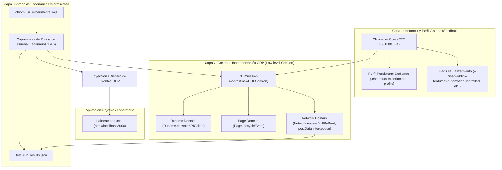

# ARQUITECTURA DE CHROMIUM EXPERIMENTAL Y CONTROL POR CDP

**Directorio del perfil:** `C:\Users\Mi Equipo\Documents\ChromiumQuizzis\.chromium-experimental-profile`  
**Ejecutor de pruebas:** [`chromium_experimental.mjs`](file:///c:/Users/Mi%20Equipo/Documents/ChromiumQuizzis/chromium_experimental.mjs)  
**Motor subyacente:** Chrome for Testing `156.0.8078.4` (v1248)  
**Protocolo de control:** Chrome DevTools Protocol (CDP)

---

## 1. Principios de Diseño del Entorno Experimental

Para investigar los mecanismos de supervisión sin contaminar el navegador de uso diario ni alterar el código C++ antes de aislar las variables del problema, se implementó una **instancia de Chromium desacoplada** con tres capas de aislamiento:

---

## 2. Configuración y Flags del Navegador

La instancia se lanza mediante `chromium.launchPersistentContext` con los siguientes argumentos especializados:

| Flag de Chromium | Justificación Técnica |
| :--- | :--- |
| `--user-data-dir=./.chromium-experimental-profile` | Garantiza un almacenamiento aislado para cookies, localStorage, indexedDB y cachés sin afectar perfiles reales del sistema. |
| `--disable-blink-features=AutomationControlled` | Elimina la bandera `navigator.webdriver` por defecto para evitar que scripts del sitio alteren su comportamiento ante detección de bots. |
| `--disable-background-timer-throttling` | Impide que el motor de render reduzca la frecuencia de ejecución de `setTimeout` o `setInterval` cuando la ventana o pestaña pierde el foco, permitiendo mediciones temporales de laboratorio con precisión de milisegundos. |
| `--disable-backgrounding-occluded-windows` | Evita que Chromium suspenda procesos de renderizado cuando la ventana es ocluida visualmente por otra ventana del sistema operativo. |
| `--disable-renderer-backgrounding` | Mantiene el hilo de JavaScript en prioridad normal durante las transiciones de estado de ventana. |

---

## 3. Instrumentación Mediante Chrome DevTools Protocol (CDP)

El arnés se conecta directamente al socket de depuración de Chromium a través de tres dominios CDP fundamentales:

### A. Dominio `Network`
- **Método activador:** `Network.enable`
- **Evento clave:** `Network.requestWillBeSent`
- **Función:** Intercepta a nivel de red (previo al cifrado y envío de socket) las solicitudes dirigidas a `/v1/games/:id/player-infraction` y `/api/telemetry`, extrayendo:
  - Timestamp con resolución ISO.
  - Método HTTP (`POST`).
  - `postData` decodificado (payload completo con `infractionType`, `questionId`, `timeOutOfFocus`, `clipboardLength`, etc.).

### B. Dominio `Page`
- **Método activador:** `Page.enable`
- **Evento clave:** `Page.lifecycleEvent`
- **Función:** Monitorea las transiciones de ciclo de vida del documento (`init`, `DOMContentLoaded`, `load`, `firstPaint`, `networkIdle`).

### C. Dominio `Runtime`
- **Método activador:** `Runtime.enable`
- **Evento clave:** `Runtime.consoleAPICalled`
- **Función:** Captura directamente del contexto global de JavaScript cualquier advertencia, error o log emitido por la aplicación sin depender de `page.on('console')`.

---

## 4. Reproducción Determinista de Escenarios

El arnés automatiza la ejecución secuencial de los casos de prueba sin intervención humana:

1. **Escenario 1 (Grace Period):** Despacha `blur`, espera 1200 ms ($< 3000\text{ ms}$), despacha `focus`. Comprueba que el servidor registre **0** infracciones.
2. **Escenario 2 (Pérdida prolongada):** Despacha `blur`, espera 3500 ms ($> 3000\text{ ms}$), despacha `focus`. Comprueba la recepción y orden de `playerExited` y `playerResumed` con el parámetro `timeOutOfFocus` exacto.
3. **Escenario 3 (Menú contextual):** Ejecuta un clic derecho forzado en la zona de prueba. Comprueba `rightClickDetected`.
4. **Escenario 4 (Portapapeles):** Inyecta un `ClipboardEvent('paste')` con payload sintético. Comprueba `pasteDetected` y la medición de caracteres.
5. **Escenario 5 (Redimensión):** Modifica el viewport a $750\times 600$, espera 800 ms (superando el debounce de 500 ms). Comprueba `windowResizeDetected`.
6. **Escenario 6 (Pantalla completa):** Activa `focusMode` y genera un evento de salida `fullscreenchange`. Comprueba `fullscreenExitDetected`.

Todos los resultados se exportan de forma estructurada a [`test_run_results.json`](file:///c:/Users/Mi%20Equipo/Documents/ChromiumQuizzis/test_run_results.json).
