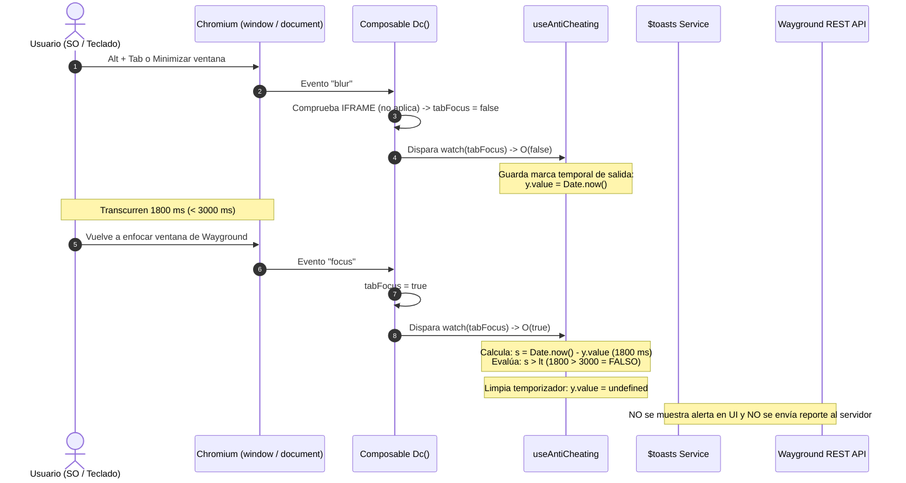
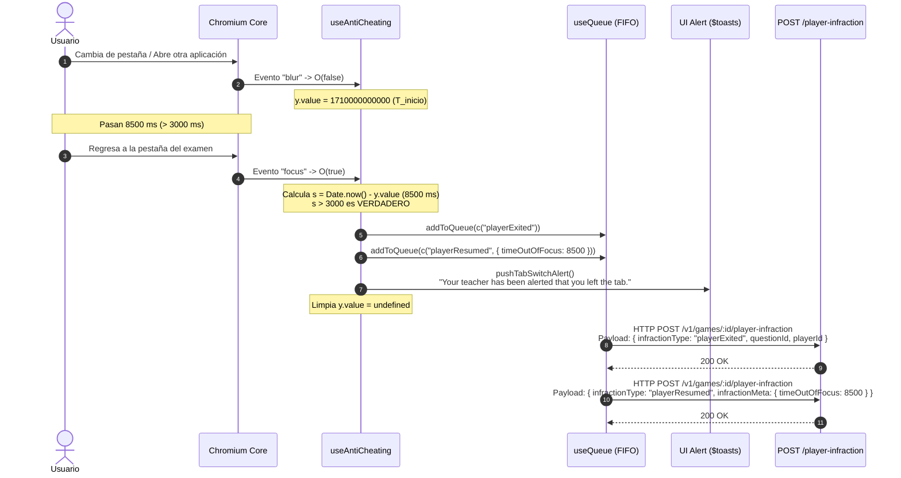
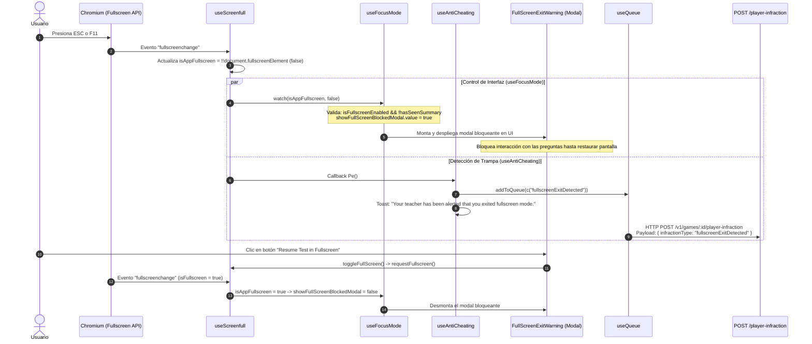
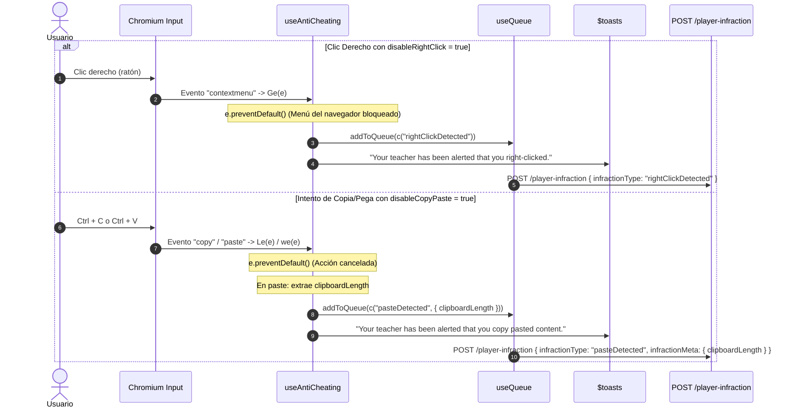
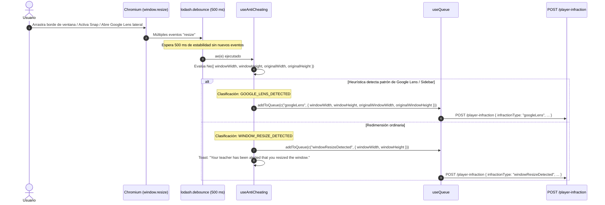
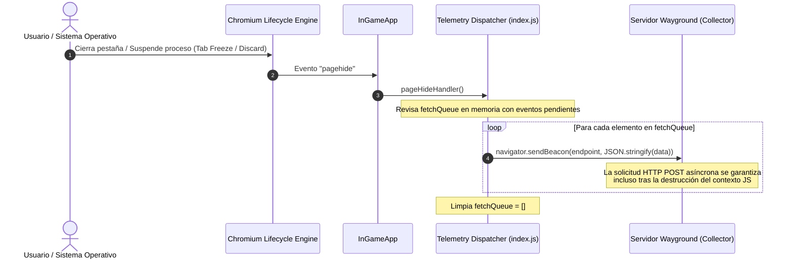

# RECONSTRUCCIÓN DEL FLUJO DE EVENTOS — WAYGROUND (QUIZIZZ)

**Estado de verificación:** Código comprobado a partir de los manejadores desminificados en `useAntiCheating.DbXxYjR9.js`, `useFocusMode.VI9SmPm8.js`, `useScreenfull.DjUvoJkM.js` e `InGameApp.DILvyiP8.js`.

---

## 1. Escenario A: Pérdida y Recuperación Rápida de Foco (Margen $\le$ 3000 ms)

Wayground implementa una constante de tolerancia estricta (`const lt = 3000`). Si el usuario cambia brevemente de ventana o minimiza pero regresa en menos de 3 segundos, la infracción se descarta.



---

## 2. Escenario B: Pérdida Prolongada de Foco (> 3000 ms)

Cuando la ausencia supera el margen de 3 segundos, al regresar el sistema emite dos infracciones ordenadas cronológicamente para reconstruir el historial exacto del incidente.



---

## 3. Escenario C: Salida de Pantalla Completa en Modo Foco

El modo examen exige pantalla completa obligatoria. Si el usuario pulsa `Esc`, `F11` o una combinación de teclas del sistema para salir de pantalla completa, se desencadena una doble acción: advertencia visual bloqueante y reporte inmediato.



---

## 4. Escenario D: Menú Contextual (Clic Derecho) y Portapapeles



---

## 5. Escenario E: Redimensionamiento de Ventana y Detección de Google Lens



---

## 6. Escenario F: Ciclo de Vida de Página y Vaciado Abrupto (`Page Lifecycle`)

Cuando el usuario cierra la ventana, recarga abruptamente o el sistema suspende el proceso de Chromium:



---

## 7. Gestión de Errores y Reintentos en el Canal de Transporte

1. **Captura local de excepciones:** Toda llamada en cola está envuelta en bloques `try / catch`:
   ```javascript
   c = (e, t, s) => async () => {
     if (!n.isLDBEnabled)
       try {
         const u = Re(e, t, s);
         const p = { infractionType: u.activityType, playerId: u.playerId, questionId: u.questionId, infractionMeta: u.infractionMeta };
         return await at(p, B.value);
       } catch (u) {
         h.error("Error creating test game activity:", u);
       }
   };
   ```
2. **Resiliencia de la interfaz:** Si la red se cae o el endpoint `/player-infraction` devuelve un código de error HTTP (500/503), el error solo se imprime en consola (`h.error`). El motor del juego **no detiene** la partida ni bloquea al estudiante, permitiendo continuar contestando.
3. **Reintentos en Balizas (`sendUsingBeacon`):** Para eventos analíticos generales, si `navigator.sendBeacon` retorna `false` (cola del navegador llena), implementa un reintento con retardo exponencial:
   ```javascript
   sendUsingBeacon(t, s, n = 0) {
     const o = JSON.stringify(t);
     if (!navigator.sendBeacon(this.getEventEndpoint(s), o) && n < fA) {
       const r = pA(n); // Backoff exponencial
       setTimeout(() => { this.sendUsingBeacon(t, s, n + 1); }, r);
     }
   }
   ```
