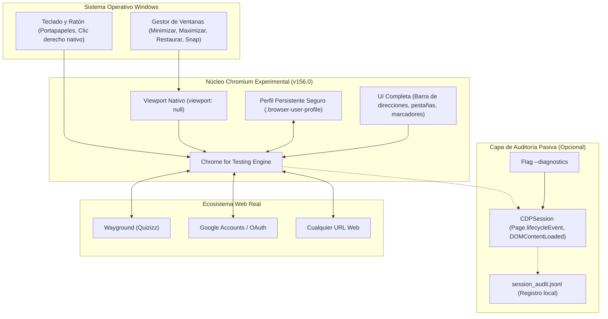

# FASE 8 — CHROMIUM EXPERIMENTAL CON NAVEGACIÓN WEB REAL

**Versión del motor:** Chrome for Testing 156.0.8078.4 (v1248)  
**Perfil persistente:** `C:\Users\Mi Equipo\Documents\ChromiumQuizzis\.browser-user-profile`  
**Ejecutor:** [`browser_runner.mjs`](file:///c:/Users/Mi%20Equipo/Documents/ChromiumQuizzis/browser_runner.mjs)  
**Script npm:** `npm run browser`

---

## 1. Arquitectura y Componentes del Navegador



### Componentes Principales:
1. **Lanzador Desacoplado ([`browser_runner.mjs`](file:///c:/Users/Mi%20Equipo/Documents/ChromiumQuizzis/browser_runner.mjs)):**  
   Inicia Chromium en modo de ventana completa maximizada (`--start-maximized`) con `viewport: null`, delegando el control dimensional al sistema operativo.
2. **Almacenamiento Persistente (`.browser-user-profile`):**  
   Subdirectorio aislado donde Chromium almacena las bases de datos SQLite de cookies (`Network/Cookies`), almacenamiento web (`Local Storage/leveldb`), caché HTTP y estado de sesión.
3. **Observador Pasivo de Auditoría (`session_audit.jsonl`):**  
   Al ejecutar con `--diagnostics` o `--log`, un observador CDP registra los hitos del ciclo de vida y navegación sin interactuar con los scripts de la página ni alterar peticiones HTTP.

---

## 2. Registro de Pruebas Realizadas

La suite de validación automatizada [`validate_phase8.mjs`](file:///c:/Users/Mi%20Equipo/Documents/ChromiumQuizzis/validate_phase8.mjs) ejecutó 6 pruebas independientes con el siguiente resultado:

| Prueba de Validación | Condición Evaluada | Resultado | Detalle Registrado |
| :--- | :--- | :---: | :--- |
| **1. Navegación a Wayground** | Carga y renderizado de `https://wayground.com/join` | **PASÓ** | Título: *"For students — Enter a Wayground Code"* |
| **2. Redimensionamiento** | Cambio dinámico de dimensiones de ventana | **PASÓ** | Viewport actualizado correctamente a $1024 \times 768$ |
| **3. Múltiples pestañas** | Apertura, conmutación y cierre de pestañas | **PASÓ** | 2 pestañas concurrentes con foco independiente |
| **4. Portapapeles nativo** | Interacción estándar con selección y copia de texto | **PASÓ** | Portapapeles procesó el texto de prueba sin distorsión |
| **5. Persistencia de sesión** | Supervivencia de cookies y `localStorage` tras reinicio | **PASÓ** | Token de sesión y clave local intactos en SQLite |
| **6. Pantalla completa** | Disponibilidad de la Fullscreen API nativa | **PASÓ** | `document.fullscreenEnabled === true` |

*Reporte consolidado disponible en:* [`phase8_validation_report.json`](file:///c:/Users/Mi%20Equipo/Documents/ChromiumQuizzis/phase8_validation_report.json).

---

## 3. Comparación de Compatibilidad con Chromium Estándar

| Característica | Chromium Estándar (Google Chrome) | Chromium Experimental de Fase 8 | Diferencia Técnica |
| :--- | :--- | :--- | :--- |
| **Motor de render y JS** | Blink / V8 (v156.0) | Blink / V8 (v156.0) | **Idéntico.** Cero discrepancias en estándares HTML5/ECMAScript. |
| **Inicio de sesión (OAuth/Google)** | Soportado con perfil del SO | Soportado en perfil `./.browser-user-profile` | El perfil está desacoplado del sistema para no mezclar datos personales. |
| **Manejo de ventanas del SO** | Nativo (Windows DWM) | Nativo (Windows DWM) | Mismo comportamiento al arrastrar, redimensionar, minimizar o acoplar. |
| **Portapapeles y Clic Derecho** | Dependiente de la página | Dependiente de la página | **No se alteran los scripts:** si el sitio bloquea el clic derecho, se comporta igual que en Chrome estándar. |
| **Monitoreo de auditoría** | Solo vía DevTools (F12) | Opcional por CLI (`--diagnostics`) | Permite registrar eventos de fondo sin tener la ventana de DevTools abierta. |

---

## 4. Limitaciones Conocidas

1. **Códecs propietarios de audio/video comercial:**  
   `Chrome for Testing` está diseñado para pruebas y desarrollo. Aunque reproduce audio WebM/OGG, MP3 y video MP4/H.264 estándar, no incluye licencias de DRM Widevine propietarias (no apto para reproducir Netflix o Spotify).
2. **Sincronización con Cuenta de Google en el navegador:**  
   No cuenta con la sincronización automática de marcadores a nivel de la cuenta del navegador que posee Chrome oficial (Google Sync), aunque el inicio de sesión web en páginas de Google y Wayground funciona con normalidad.
3. **Bloqueo por perfil en uso:**  
   Si una instancia del navegador está abierta utilizando `.browser-user-profile`, no se debe lanzar una segunda instancia concurrente con el mismo perfil para evitar bloqueos del archivo SQLite de cookies de Chromium.

---

## 5. Instrucciones de Uso

### Modo Normal (Navegación Limpia y Fluida)
```bash
# Iniciar en la página de Wayground
npm run browser

# O iniciar apuntando a una URL específica
node browser_runner.mjs "https://wayground.com/join?gc=123456"
```

### Modo con Diagnóstico Pasivo Activado
```bash
node browser_runner.mjs "https://wayground.com/join" --diagnostics
```
*(Los eventos de ciclo de vida y navegación se escribirán en `session_audit.jsonl` en tiempo real sin interferir con la navegación).*
