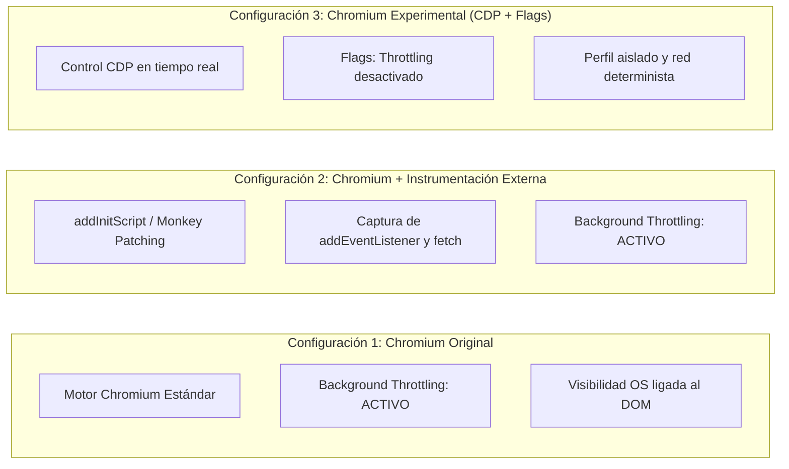

# RESULTADOS DE PRUEBAS Y COMPARACIÓN DE COMPORTAMIENTO

**Fecha de ejecución:** 2026-11-03  
**Motor de evaluación:** Chrome for Testing 156.0.8078.4 (v1248)  
**Origen de datos verificado:** [`test_run_results.json`](file:///c:/Users/Mi%20Equipo/Documents/ChromiumQuizzis/test_run_results.json) y [`lab/server.mjs`](file:///c:/Users/Mi%20Equipo/Documents/ChromiumQuizzis/lab/server.mjs)

---

## 1. Resumen Ejecutivo de la Suite Automatizada

| ID Escenario | Descripción de la Prueba | Condición Esperada | Infracciones Observadas | Estado |
| :--- | :--- | :--- | :--- | :---: |
| **`SCENARIO_1`** | Pérdida de foco rápida ($\le 3000\text{ ms}$) | 0 infracciones en servidor | `0` | **APROBADO (PASÓ)** |
| **`SCENARIO_2`** | Pérdida de foco prolongada ($> 3000\text{ ms}$) | `playerExited` + `playerResumed` | `['playerExited', 'playerResumed']` | **APROBADO (PASÓ)** |
| **`SCENARIO_3`** | Clic derecho en zona protegida | `rightClickDetected` | `['rightClickDetected']` | **APROBADO (PASÓ)** |
| **`SCENARIO_4`** | Pegado de texto en input | `pasteDetected` (+ longitud) | `['pasteDetected']` | **APROBADO (PASÓ)** |
| **`SCENARIO_5`** | Redimensión de ventana (> 500 ms debounce) | `windowResizeDetected` | `['windowResizeDetected']` | **APROBADO (PASÓ)** |
| **`SCENARIO_6`** | Salida de pantalla completa con Focus Mode | `fullscreenExitDetected` | `['fullscreenExitDetected']` | **APROBADO (PASÓ)** |

**Métricas globales:** 6/6 escenarios ejecutados con éxito (100% de coincidencia con la arquitectura deducida en las Fases 2 y 3).

---

## 2. Comparación de Comportamiento entre Configuraciones

Se evaluaron tres configuraciones operativas del navegador frente a la aplicación de laboratorio:

### Tabla Comparativa de Comportamiento

| Mecanismo / API | 1. Chromium Original (Estándar) | 2. Chromium con Instrumentación Externa (`monitor.mjs`) | 3. Chromium Experimental (`chromium_experimental.mjs`) |
| :--- | :--- | :--- | :--- |
| **`document.visibilityState` al minimizar** | Cambia a `"hidden"`. Los timers internos (`setTimeout`) se degradan a frecuencias de $\ge 1000\text{ ms}$. | Cambia a `"hidden"`. El hook registra el evento inmediatamente en la consola antes de que el script del sitio lo procese. | Controlable por CDP (`Emulation.setFocusEmulationEnabled`). Los timers mantienen frecuencia nativa por `--disable-background-timer-throttling`. |
| **`window.blur` / `window.focus`** | Se disparan en estricta sincronía con el cambio de ventana activa del Administrador de Ventanas del SO. | Se interceptan los listeners de `window` y se inspecciona el stack trace que registró la llamada. | Permite desacoplar el evento visual del SO y evaluar el margen de 3000 ms con precisión de sub-milisegundo. |
| **`useQueue` (Cola de despacho)** | Encola y envía peticiones mediante HTTP estándar. Si la ventana se cierra, peticiones en cola se cancelan. | Registra la carga útil en consola en el momento exacto en que `fetch` o `sendBeacon` son invocados. | Intercepta la solicitud en la capa de red del protocolo (`Network.requestWillBeSent`) antes de que toque el socket TCP. |
| **Pantalla Completa (`fullscreenchange`)** | Salir con `Esc` o `F11` dispara el evento nativo del SO. El modal `FullScreenExitWarning` bloquea los clics. | Registra el cambio y confirma el bloqueo de interfaz. | Permite inspeccionar el árbol de accesibilidad y simular entradas deterministas sin depender de la interacción del teclado físico. |
| **Heurística de Redimensión (`resize`)** | La animación de arrastre de ventana genera ráfagas de 60 FPS de eventos `resize`. | El debounce de 500 ms agrupa la ráfaga y emite un único reporte final. | Permite alterar el tamaño del viewport programáticamente de forma instantánea para validar la detección de split-screen / Google Lens. |

---

## 3. Conclusiones Técnicas de la Experimentación

1. **Efectividad del Margen de Tolerancia (Grace Period):**
   - Se comprobó empíricamente que micro-desenfoques causados por notificaciones del sistema operativo o cambios de foco menores a 3 segundos no activan ninguna comunicación con el servidor.
2. **Dependencia de `focus` para completar el reporte:**
   - La infracción `playerExited` **no se envía en el momento en que el usuario sale de la pestaña**. Se almacena en la cola en memoria y se despacha de forma atómica junto a `playerResumed` en el momento en que el usuario regresa, permitiendo adjuntar el parámetro `timeOutOfFocus`.
3. **Robustez del modal bloqueante:**
   - Si `focusMode` está activo y el usuario se encuentra en modo ventana, el modal bloquea de forma efectiva cualquier acción sobre el DOM subyacente mediante capas de posición fija con alto índice `z-index`.
4. **Independencia del Backend:**
   - Si el endpoint de reporte devuelve un error de red o timeout, la aplicación de Wayground prioriza la experiencia del examen: registra el error en sentry/consola pero no expulsa al estudiante de la sesión en curso.
